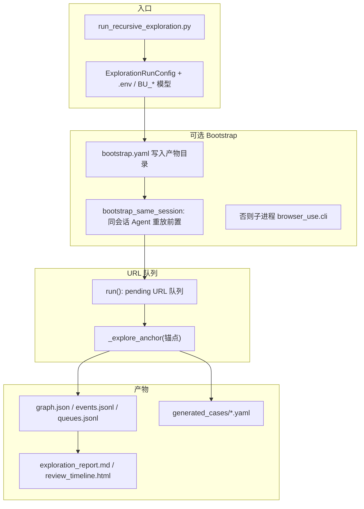
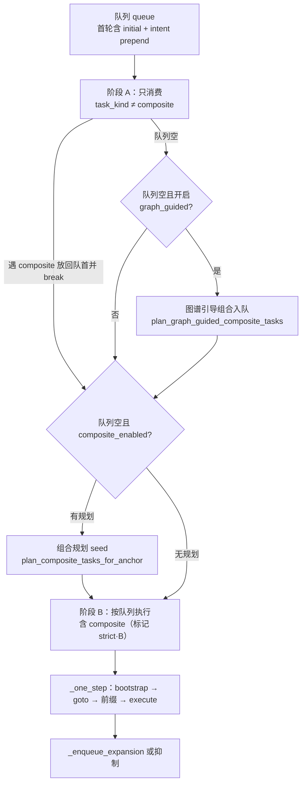
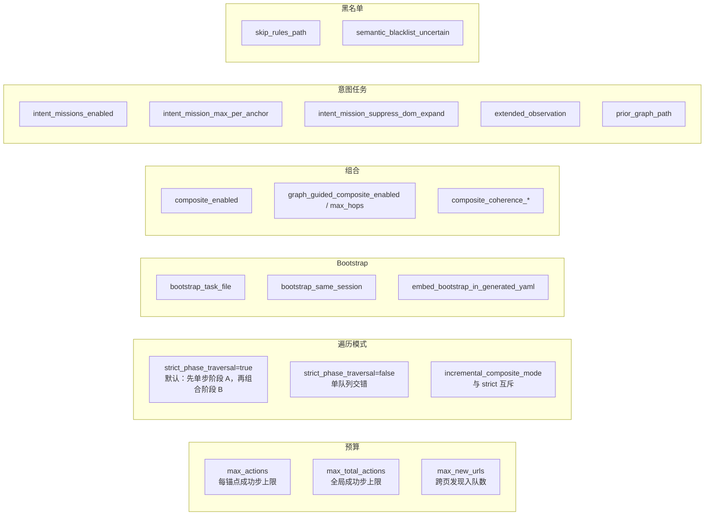

# 递归探索（`run_recursive_exploration`）链路与调参速查

本文描述 `RecursiveExplorer` 从入口到产物的**主执行顺序**、**严格阶段模型（默认）**、**意图任务**与**主要 CLI/配置**的对应关系，便于调参。实现以 **`package/recursive_exploration/explorer.py`** 为准。

---

## 1. 全局长链路（从 CLI 到 graph.json）

**要点**

- **每个锚点**在一次 `_explore_anchor` 内完成：枚举 → 入队 →（可选）意图规划 → 队列执行循环。
- **每条队列任务**在新 `BrowserContext` 里：**replay bootstrap → `_maybe_goto_anchor`(锚点一致则跳过 goto) → 前缀重放 → `_execute_click_task`**（含 intent_mission / composite / 单步点击输入）。
- **`max_actions`**：单锚点「成功步」上限；**`max_total_actions`**：整 run 全局成功步上限。
- **`prior_graph_path`**：仅加载 **dedupe 路径键**（增量组合去重）；意图规划会 **额外** 读 prior `graph.json` 边摘要（若配置了路径）。

---

## 2. 单锚点 `_explore_anchor` 顺序（执行步骤）

| 步骤 | 代码位置概念 | 说明 |
|------|----------------|------|
| 1 | 专用枚举上下文 `enum_ctx` | 与执行任务时顺序一致，避免索引漂移 |
| 2 | `replay_bootstrap_agent_if_yaml` | 同会话重放 `bootstrap.yaml`（若存在） |
| 3 | `_maybe_goto_anchor` | 与规范化锚点 URL 一致则 **不 goto**，保护 SPA 状态 |
| 4 | `_settle_after_task_nav` | 导航后等待 |
| 5 | `get_state` → `_observation` | 标题、selector_map、page_state_id 等 |
| 6 | 可选 `_scroll_enumerate` | `--scroll-enumerate` 时扩大首轮候选 |
| 7 | `_enqueue_initial` | DOM 候选 → `ActionTask`（单步），受 `max_initial_candidates`、黑名单等约束 |
| 8 | `_maybe_enqueue_intent_missions` | `intent_missions_enabled` 且相位 `anchor_start`：LLM → **prepend** 意图任务 |
| 9 | 关闭 `enum_ctx` | 枚举结束 |
| 10 | `strict_phase_traversal`？ | **是** → `_explore_anchor_strict_phases`；**否** → 简单 while 队列循环 |

---

## 3. `strict_phase_traversal=true`（默认）时的阶段逻辑

**`_one_step` 内（每条任务）**

1. 新开任务上下文 → **bootstrap replay** → **`_maybe_goto_anchor`** → 前缀重放（含截图链）
2. **`_execute_click_task`**：
   - `intent_mission` → `replay_intent_mission_yaml_on_context`（Agent，无初始 go_to）
   - `composite` → `execute_composite_chain`
   - 否则 DOM 点击 / 输入 / 滚动
3. 成功则 `actions_executed++`，写事件/边/YAML（策略见 `yaml_policy`）
4. **`_enqueue_expansion`**：基于新页面观测扩队；若 **`intent_mission_suppress_dom_expand`** 且上一 success 设置了抑制，则 **整轮跳过扩队**一次

**说明**：配置项 **`composite_checkpoint_every_single_successes`** 在报告与配置中存在；当前 strict 主路径以「阶段 A 结束 → seed 组合 → 阶段 B」为主，若需「每 N 次单步插入组合」需对照分支是否在你使用的 `execution_mode` 下生效。

---

## 4. 可选参数 → 行为（调参流程图）

| 参数 / 区域 | 作用摘要 |
|-------------|----------|
| **预算** | `max_actions` 卡单锚点；`max_total_actions` 卡整 run；达到后队列审计 `budget_truncated`。 |
| **strict vs fast** | `strict_phase_traversal`（默认 true）：阶段 A 只吃单步，再放入组合；false 时同一队列循环（旧交错语义）。 |
| **Bootstrap** | `bootstrap_task_file` + `bootstrap_same_session`：前置与探索同会话；关闭则用 CLI 子进程冷启动前置。 |
| **组合** | `composite_enabled` 关则无双阶段 seed；`graph_guided_*` 在 **阶段 A 队列排空** 且启用时注入图谱链组合任务。 |
| **意图** | `intent_missions_enabled`：首轮入队后 LLM 规划，`intent_mission_*` 控制条数/扩队抑制；`extended_observation` 丰富规划输入；`prior_graph_path` 供 dedupe + 意图摘要。 |
| **黑名单** | `skip_rules.json` 等 → `ActionSkipEvaluator`，可在入队/组合阶段跳过。 |
| **续跑** | `--resume-session` 指向含 `session_state.json` 的目录；提高 `max_actions` 可触发「已完成」会话再次入队入口锚点。 |

---

## 5. 产物与审计对应

| 产物 | 内容 |
|------|------|
| `queues.jsonl` | url 入队/跳过、action 入队/出队、`intent_mission_*`、`budget_truncated` |
| `events.jsonl` | 每步结果、`task_source`、`step_origin` |
| `graph.json` | 节点/边、`prior` 合并时可参考 |
| `generated_cases/*.yaml` | 可 `python -m browser_use.cli --task-file ...` 独立回放 |
| `intent_mission_plan_audit.jsonl` | 意图规划原始片段与校验结果 |
| `exploration_report.md` | 配置快照 + 统计汇总 |

---

## 6. 与「独立 CLI 成功 / 探索内 Agent 失败」的关系

- **探索内 intent** 与 **独立 `browser_use.cli`** 共用同一套 YAML 语义，但探索里 Agent 受 **同会话上下文、全局步数上限、任务预算** 影响，可能出现「CLI 单独跑成功、嵌入探索超时」的差异；可调：缩短意图 `ai_steps`、提高 Agent 允许步数（需在 `intent_mission_exec` / Tasks 配置侧对齐）、或增大 `max_actions`/`max_total_actions`。

如需把某一 OpenSpec 变更与上述阶段对齐，见 `openspec/changes/` 下对应 `design.md`。
